# RHP — Remote Hot Patch · Architecture

> **Language:** C++23 · **Build:** CMake ≥ 3.28, Ninja Multi-Config, CPM.cmake · **License:** Apache-2.0
> **Targets:** Windows 10 1809+ · Linux (glibc 2.31+) · macOS 13+ · iOS 16+ · Android API 26+ — x86_64 + arm64
> **Compilers:** MSVC (VS 2026) · clang-cl · Clang 17+ · AppleClang · Android NDK Clang
> **Root namespace:** `Rhp::` · **Include root:** `<rhp/...>`
> **Progress model:** work advances in **stages** (Stage 0, Stage 1, …). Nothing in code, files, tags, or APIs is ever named `v1`/`v2`/`V*`. The only numbers on the wire are a plain `protocol_revision` integer and per-module `revision` counters.

---

## 0. What RHP is

**One sentence:** *RHP is a portable, compile-time-configured C++23 static library that lets a running program accept authenticated, signed Lua scripts over pluggable transports, run them in a sandbox against a C++-declared API surface, stream results back, and fully undo what they did.*

| Requirement | How RHP meets it |
|---|---|
| Plug-and-play, expandable from outside | every axis is a **policy** checked by a **concept**; users add types/specializations, never edit RHP |
| Heavy `<>::` chaining | configuration and bindings are type-level DSLs: `Rhp::config<>::transport<..>::auth<..>`, `Rhp::lib<"game">::fn<..>::var<..>` |
| C++ is the executor, Lua is glue | Lua only reaches what C++ exposed via `Rhp::lib<>` and `Rhp::patch_point<>` |
| Loaded / unload / revert / reload | managed **modules** + an **undo ledger** + per-module revision history + global checkpoints |
| Portable to 5 OSes | no OS headers in public API; OS code only in `Src/rhp/platform/detail/*` and backend `.cpp`s |
| Network + error correction handled by RHP | framing, CRC32C, seq/ack, idempotency, heartbeat, reconnect, resume |
| Easy to use | `Rhp::config<>` with zero arguments is a complete, safe config; a host is ~10 lines |

**Use cases (decided):** game hot patching / modding · live tuning of dev builds · QA / test automation · server admin / ops · reverse-engineering / research tooling.

---

## 1. Big picture

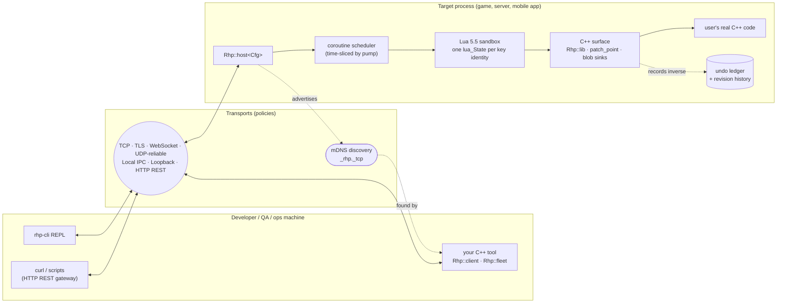

**Key principle:** a script never "gets the process". It gets a capability table whose contents depend on its caller's **role**.

---

## 2. Layered architecture

Each layer may only depend on layers below it. Enforced in CMake (a lower target never links a higher one).

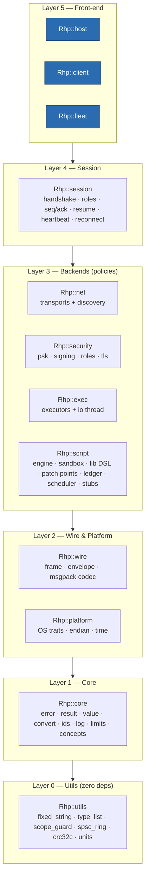

| Layer | Namespace | May know | Must not know |
|---|---|---|---|
| 0 | `Rhp::utils` | standard library | RHP, OS, Lua, sockets |
| 1 | `Rhp::core` | utils | Lua, sockets, threads |
| 2 | `Rhp::wire`, `Rhp::platform` | core | Lua, sessions |
| 3 | `Rhp::net`, `Rhp::security`, `Rhp::exec`, `Rhp::script` | layers 0–2 | each other |
| 4 | `Rhp::session` | backends **through concepts only** | concrete backend types |
| 5 | `Rhp::host`, `Rhp::client`, `Rhp::fleet` | everything, via `Rhp::config<>` | — |

Naming: everything is **snake_case** (std-like) under the `Rhp::` root — `Rhp::host`, `Rhp::script::patch_point`, `Rhp::errc::kBudgetExceeded`.

---

## 3. Extension model ("Render-API" style)

A stable front-end over swappable backends. Every backend slot is a concept; users plug in their own types. Extensions ship as **separate CMake targets** (compile-time only — no runtime-loaded plugin DLLs).

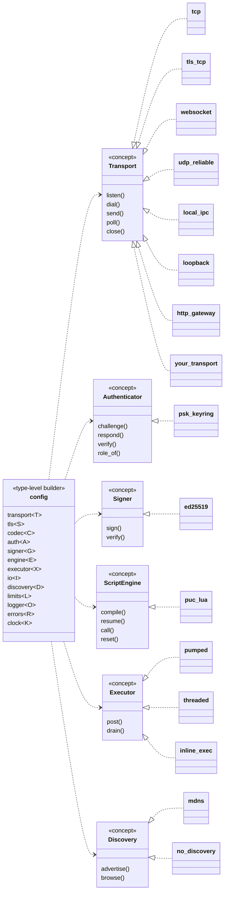

### 3.1 Customization points

| Extension point | Kind | User does | Example |
|---|---|---|---|
| Transport | concept policy | satisfy `Rhp::net::transport` | Steam P2P, USB serial, in-house relay |
| TLS backend | concept policy | satisfy `Rhp::security::tls_backend` | platform TLS |
| Codec | concept policy | satisfy `Rhp::wire::codec` | debug JSON codec |
| Authenticator | concept policy | satisfy `Rhp::security::authenticator` | company SSO token |
| Script signer | concept policy | satisfy `Rhp::security::signer` | HSM-backed signing |
| Executor | concept policy | satisfy `Rhp::exec::executor` | your job system |
| I/O threading | concept policy | satisfy `Rhp::exec::io_runner` | share your own `asio::io_context` |
| Discovery | concept policy | satisfy `Rhp::net::discovery` | Steam lobby, custom beacon |
| Logger | concept policy | satisfy `Rhp::core::logger` | spdlog, logcat, os_log |
| Error mode | policy | `Rhp::errors::expected` / `Rhp::errors::throwing` | exceptions in tools, expected in engine |
| Memory | runtime injection | pass a `std::pmr::memory_resource*` | arena per frame |
| Type marshaling | trait specialization | specialize `Rhp::convert<T>` | `vec3`, `entity`, `color` |
| Bindings | type-level DSL | `Rhp::lib<"name">::fn<...>` | expose functions + handles |
| Hot-patch sites | object | `Rhp::patch_point<"id", Sig>` | overridable behavior |
| Native hooking | concept policy (user supplies) | satisfy `Rhp::script::hook_backend` | wrap MinHook / Dobby / own |
| Blob sinks | runtime registration | `host.on_blob("name", fn)` | receive textures, configs |
| Events | callbacks | `host.on<Rhp::event::X>(fn)` | audit, UI notification |

---

## 4. The type-level DSL

### 4.1 Configuration chain

```cpp
#include <rhp/rhp.hpp>
using namespace Rhp::literals;                                // 32_MiB, 2_ms, ...

using my_cfg = Rhp::config<>
    ::transport<Rhp::net::tcp>
    ::tls      <Rhp::security::tls::auto_backend>             // OpenSSL on desktop, mbedTLS on mobile
    ::codec    <Rhp::wire::msgpack>
    ::auth     <Rhp::security::psk_keyring>                   // keys → identities → roles
    ::signer   <Rhp::security::ed25519>                       // scripts must be signed
    ::engine   <Rhp::script::puc_lua>
    ::executor <Rhp::exec::pumped>                            // Lua runs on the thread that calls pump()
    ::io       <Rhp::exec::owned_io_thread>                   // RHP owns one network thread
    ::discovery<Rhp::net::mdns>
    ::errors   <Rhp::errors::expected>                        // or Rhp::errors::throwing
    ::clock    <Rhp::exec::steady_clock>                      // injectable (game time, deterministic tests)
    ::limits   <Rhp::limits{}>;                               // everything unlimited, scripts run to completion
```

`Rhp::config<>` with no links equals exactly this. TLS activates automatically for non-loopback endpoints. There is **no default port** — every endpoint names one.

How it works:

```cpp
namespace Rhp {
template <class... Settings>
struct config {
    template <net::transport T>            using transport = config<detail::replace_t<slot::transport, T, Settings...>>;
    template <security::authenticator A>   using auth      = config<detail::replace_t<slot::auth, A, Settings...>>;
    template <exec::executor X>            using executor  = config<detail::replace_t<slot::executor, X, Settings...>>;
    template <Rhp::limits L>               using limits    = config<detail::replace_t<slot::limits, detail::value_tag<L>, Settings...>>;
    // ... one alias per slot

    using transport_t = detail::get_or_t<slot::transport, net::tcp,              Settings...>;
    using auth_t      = detail::get_or_t<slot::auth,      security::psk_keyring, Settings...>;
    // ... defaults for every slot
};
}
```

Each slot is concept-constrained **where you write it**. A bad transport fails on the `::transport<X>` line, not deep inside `host.hpp`.

> In your own templates (dependent context) write `Cfg::template transport<X>`. In normal code no `template` keyword is needed.

### 4.2 Binding chain

```cpp
using game_lib = Rhp::lib<"game">
    ::fn <"spawn",   &game::spawn,   Rhp::undo<&game::despawn>>    // reversible; needs role::kPatch
    ::fn <"find",    &game::find>                                   // pure → role::kObserve
    ::fn <"explode", &game::explode, Rhp::irreversible>             // allowed, reported by revert
    ::fn <"wipe",    &game::wipe,    Rhp::requires_role<Rhp::role::kAdmin>>
    ::var<"gravity", &game::g_gravity>                              // read: observe, write: patch (journaled)
    ::ro <"tick",    &game::g_tick>
    ::handle<"entity", game::entity_id, &game::is_alive>            // opaque handle type + validity check
    ::sub<Rhp::lib<"debug">
        ::fn<"dump", &game::dump_state>>;
```

```lua
local e = game.spawn("crate", 10, 0, 5)   -- returns an opaque `entity` handle
game.gravity = -4.9                         -- old value journaled
print(game.tick, game.debug.dump())
```

Compile-time guarantees: names are `Rhp::utils::fixed_string` NTTPs and **duplicates don't compile**; every parameter/return type satisfies `Rhp::convertible`; `Rhp::undo<F>` must be invocable with the original's return value.

**Binding depth (decided):** free functions, variables, and **opaque handles** (typed IDs with a validity check). No full class/inheritance binding — keeps the binder small (~1 kLOC) and every registration ledger-tracked.

### 4.3 Patch points

```cpp
float default_damage(float base, int target);

inline constexpr Rhp::patch_point<"combat.damage", &default_damage> damage{};

float d = damage(base, target);   // RHP_ENABLE=ON : one atomic load + predictable branch
                                  // RHP_ENABLE=OFF: compiles to a direct call to default_damage
```

The default is a template argument (a function pointer or a captureless lambda) and the signature is deduced from it. That keeps all per-point state in the type: it is constant-initialized (safe to call during static initialization) and registers itself in the process-wide id table before `main`.

```lua
rhp.patch("combat.damage", function(original, base, target)
    return original(base, target) * 2.0
end)
```

Patches **stack** per point, so multiple modules can patch the same point and be reverted in any order. Native machine-code hooking is not shipped; users supply a `hook_backend` policy and get the same ledger/revert semantics.

### 4.4 C++ → Lua events

C++ can fire typed events that scripts subscribe to:

```cpp
inline constexpr Rhp::lua_event<"player.died", game::entity_id, std::string_view> player_died{};

player_died.fire(id, "lava");          // RHP_ENABLE=OFF → no-op
```

```lua
rhp.on("player.died", function(id, cause) print(id, cause) end)   -- subscription is ledger-tracked
```

Like patch points, `lua_event`s live in a **process-wide registry** (any host may deliver them to its scripts). Delivery is synchronous in sandboxes owned by the firing thread and queued to the next `pump()` of every other subscribed sandbox (arguments copied). Each handler runs as its own script request, so it may `rhp.wait`. A handle-type argument arrives as the handle userdata of whichever installed lib declares that type.

### 4.5 Opaque handles

`::handle<"entity", game::entity_id, &game::is_alive>` makes `entity` a distinct userdata type in Lua. Using a handle whose validity check fails raises a Lua error (`kStaleHandle`) — never a silent `nil`.

### 4.6 Custom types

```cpp
template <> struct Rhp::convert<vec3> {
    static Rhp::value to_value(const vec3& v);                              // wire + Lua (through Rhp::value)
    static Rhp::result<vec3> from_value(const Rhp::value& v);
    static void push(Rhp::script::stack& s, const vec3& v);                 // optional Lua fast path
    static Rhp::result<vec3> pull(Rhp::script::stack& s, int index);        // optional Lua fast path
};
```

`to_value` / `from_value` alone are enough for bindings; `push` / `pull` only skip the `Rhp::value` round trip.

No reflection-based automation; `convert<T>` is always written by hand (decided).

### 4.7 Editor stubs (LuaLS)

Every `Rhp::lib<>` can emit **LuaLS annotations** so script authors get autocomplete and type checks:

```cpp
Rhp::script::stubs::write<game_lib>(std::cout, Rhp::role::kPatch);   // compile-time walk of the lib type
std::string all = box.stubs();             // rhp API + every installed lib, for the sandbox's role
```

```lua
---@meta
---@class game
---@field gravity number
game = {}

---@param kind string
---@param x number
---@param y number
---@param z number
---@return entity
function game.spawn(kind, x, y, z) end
```

Stubs are filtered by role: functions the role can't call are left out and variables it can't write are marked `read-only`. Parameters are named `arg1..argN` (C++ has no parameter names without reflection); a `Rhp::convert<T>` names its Lua type with `static constexpr std::string_view lua_type`. `rhp-cli stubs > rhp_api.lua` fetches them from a running host (`op::describe`).

---

## 5. Scripts: lifecycle, scheduling, revert

### 5.1 Operations

| Op | Meaning | Min role |
|---|---|---|
| `exec(src)` | run once; effects **kept**, owned by the identity's **scratch module** (`revert(scratch)` undoes all REPL effects) | observe¹ |
| `load(name, src)` | compile, run top level, `on_load()`; loading an existing name = transactional reload | patch |
| `call(mod, fn, args...)` | call an exported module function | observe¹ |
| `reload(mod, src)` | compile new → `on_save()` old → revert old → swap → `on_restore(state)`; on failure old stays untouched | patch |
| `rollback(mod, n)` | swap back to a stored earlier **revision** (last N kept, configurable, default 8) | patch |
| `pin(mod)` / `unpin(mod)` | hand a module to the host so it survives disconnect (§5.7) | admin |
| `checkpoint(tag)` / `revert_to(tag)` | global ledger marks | patch |
| `revert(mod)` | undo every effect of `mod`; module stays loaded, inert | patch |
| `unload(mod)` | `on_unload()` → revert → drop `_ENV` → forget | patch |
| `revert_all()` | panic button: every module of every identity unloaded | admin |
| `cancel(req)` | stop a running script/coroutine | same identity or admin |
| `list` / `status` / `describe` | introspection, stubs | observe |
| `blob(sink, bytes)` | push a file to a host-registered sink (chunked) | admin (per-sink overridable) |

¹ observe sessions can run code, but any binding that mutates host state fails with `errc::kForbidden`.

### 5.2 Module state machine

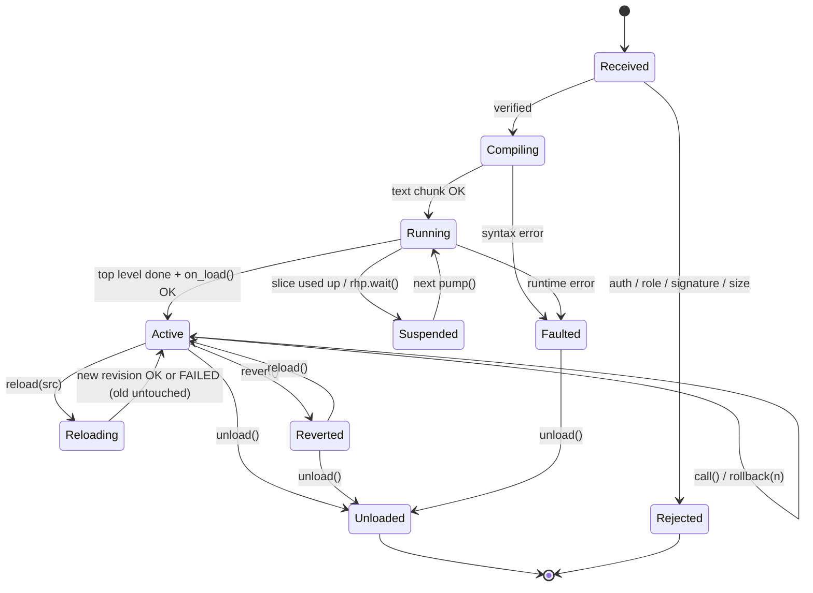

**Fault policy (decided):** on runtime error the module's effects are auto-reverted and it stays in `Faulted` for inspection (`status` shows the traceback) until unloaded or reloaded.

### 5.3 Scheduler, limits, cancel

**Decided:** totals are unlimited and scripts **run to completion** by default (`slice_us = 0`). Every script still runs as a coroutine, so `rhp.wait(frames)`, `rhp.sleep(ms)`, `rhp.next_frame()` and `rhp.timer(ms, fn)` (ledger-tracked) let scripts spread work across frames **when they choose to**.

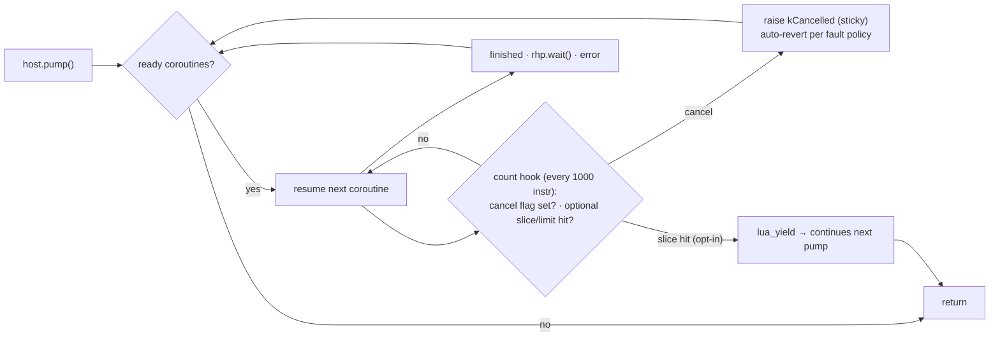

| Knob | Default | Effect |
|---|---|---|
| `limits.slice_us` | `0` = run to completion | opt-in time slicing per `pump()` |
| `limits.instructions` / `memory` / `wall_ms` | `0` = unlimited | opt-in totals, per config or per role; **sticky** when hit (re-raise every tick, allocator keeps refusing) so `pcall` can't swallow them |
| cancel flag | always on | set by the **I/O thread** (atomic) when `cancel` / `revert_all` / disconnect arrives; the count hook checks it, so a runaway loop can always be stopped **even while `pump()` is stuck inside it** |

> ⚠ Run-to-completion means an infinite loop holds the thread that called `pump()` (e.g. the game thread) until someone sends `cancel` or the client disconnects (§5.7). A count hook can't interrupt a long **C++** call, so bound functions must return.

### 5.4 Streaming output

| Lua | Wire | Client |
|---|---|---|
| `print(...)` | `op::output` frames **and** host logger | `on_output` callback / REPL prints live |
| `rhp.emit(value)` | `op::emit` frames tied to the request id | callback, or `co_await` an async stream |
| `return ...` | `op::result` | final `Rhp::result<T>` |

### 5.5 Undo ledger

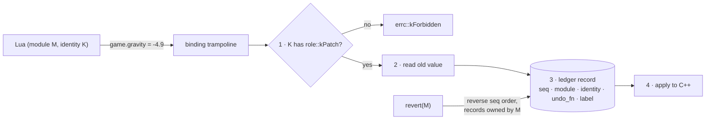

| Effect | Recorded inverse |
|---|---|
| `::var` write | restore old value |
| `rhp.patch` | pop that handler from the point's stack |
| `::fn<..., Rhp::undo<F>>` | `F(result)` |
| `rhp.on(event)` / `rhp.timer` | unsubscribe / cancel |
| `hook_backend` install | uninstall |
| `::fn<..., Rhp::irreversible>` | none — reported as `irreversible_effects: N` |
| plain `::fn` | none (treated as pure) |

### 5.6 `require` between modules

Module names are dotted lowercase (`combat.low_grav`), same rule as patch ids. Chunk names are `@module_name`, so tracebacks read `@combat.low_grav:12`. Revisions are a per-module counter, with the content hash shown in `status`.

`require("name")` resolves only to **loaded modules of the same identity** (whatever their chunk returned), via a host-controlled loader — never the file system, for every role. It returns a read-only proxy that always reads the module's **current** exports, so dependents follow a reload or rollback. A require cycle fails with an error naming the chain. The host tracks the dependency graph; unloading a module that others require fails with `kHasDependents` unless `force` is passed (then dependents stay loaded and touching the unloaded module raises `kUnloaded`).

---

### 5.7 Session lifetime (disconnect = revert)

**Decided:** when a client's session ends, everything its identity did is **reverted immediately** and its `lua_State` is closed.

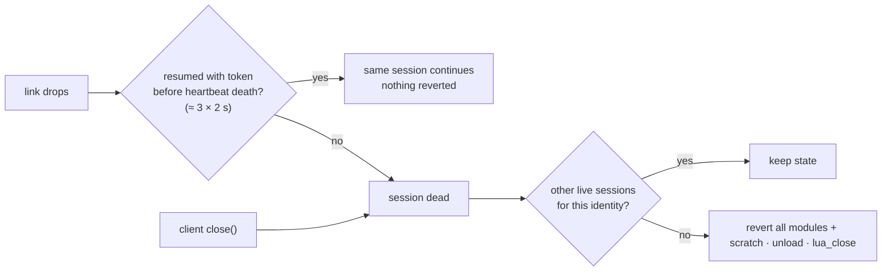

A Wi-Fi blip shorter than the heartbeat window does **not** revert; a real disconnect does.

- **`pin(mod)`** (`kAdmin`): the host takes ownership of a module, so it survives its client's disconnect. Pinned modules belong to a host-owned identity, are reverted only by `unpin` + `revert`/`unload` or `revert_all`, and are listed with `pinned: true`. This is how `rhp-cli run patch.lua --pin` applies a lasting patch.
- **HTTP gateway:** no connection, so an identity's gateway state is reverted after **5 minutes idle**.
- **Handshake flood guard:** clients are unlimited, but at most **64 unauthenticated** handshakes may be pending, each with a **5 s** timeout.

## 6. Using RHP

### 6.1 Host

```cpp
#include <rhp/rhp.hpp>

using game_lib = Rhp::lib<"game">
    ::fn <"spawn",   &game::spawn, Rhp::undo<&game::despawn>>
    ::var<"gravity", &game::g_gravity>;

int main() {
    Rhp::host<Rhp::config<>> host{
        Rhp::endpoint::listen("127.0.0.1", 7777),
        Rhp::security::keyring{
            { "dev", Rhp::security::key::from_env("RHP_KEY_DEV"), Rhp::role::kAdmin },
            { "qa",  Rhp::security::key::from_env("RHP_KEY_QA"),  Rhp::role::kPatch },
        },
        Rhp::security::trusted_signers::from_file("rhp_signers.pub"),
    };
    host.install<game_lib>();
    auto audit = host.on<Rhp::event::script_executed>(Rhp::audit::file_sink{"rhp_audit.log"});  // scoped subscription
    host.on_blob("configs", [](Rhp::blob_view b) -> Rhp::result<void> { return game::load_config(b); });

    while (game::running()) {
        host.pump();        // runs ready scripts; returns when none are ready
        game::update();
    }
}                            // ~host → revert_all()
```

What runs today (Stage 3; signers, audit and blob sinks arrive in Stage 4):

```cpp
Rhp::host<> host{Rhp::endpoint::listen("127.0.0.1", 7777),
                 Rhp::security::keyring{{"dev", *Rhp::security::key::from_env("RHP_KEY_DEV"), Rhp::role::kAdmin},
                                        {"qa",  *Rhp::security::key::from_env("RHP_KEY_QA"),  Rhp::role::kPatch}}};
host.install<game_lib>();
if (auto port = host.port(); !port) { /* address in use, non-loopback without insecure_lan, ... */ }
while (game::running()) { host.pump(); game::update(); }
```

### 6.2 Client, fleet, CLI

```cpp
Rhp::client<Rhp::config<>> c{ Rhp::endpoint::dial("192.168.1.20", 7777), identity };

auto g   = c.exec<double>("return game.gravity");                        // blocking → Rhp::result<double>
auto mod = c.load("low_grav", Rhp::source::file("scripts/low_grav.lua"));  // signed automatically by identity
c.call(*mod, "set", 1.6);
c.rollback(*mod, 1);
c.unload(*mod);

c.exec_async("return game.debug.dump()", [](Rhp::result<std::string> r) { /* callback */ });
std::future<Rhp::result<int>> f = c.exec_future<int>("return game.tick");
auto r = co_await c.async().exec<std::string>("return game.debug.dump()");    // coroutine
c.on_output([](std::string_view line) { std::println("{}", line); });

Rhp::fleet<Rhp::config<>> fleet{ identity };
fleet.discover(Rhp::net::mdns::browse{ "_rhp._tcp" });
auto results = fleet.exec<int>("return game.tick");                      // one result per host
```

Stage 3 ships the blocking half: `connect`, `exec` / `exec<T>`, `load`, `call`, `reload`, `rollback`, `revert`, `unload` (with `force`), `checkpoint`, `revert_to`, `revert_all`, `list`, `status`, `describe` and `cancel()`, with `client_options::on_output` / `on_emit` for streamed output. `exec_async`, futures, `co_await`, `fleet` and `rhp-cli` are Stage 4.

Error mode `Rhp::errors::throwing` makes the same calls return `T` and throw `Rhp::exception` (carrying the `Rhp::error`). Per call, `Rhp::unwrap(c.exec<int>(...))` does the same.

```bash
rhp-cli connect 192.168.1.20:7777 --identity ~/.rhp/dev.key
```

`rhp-cli` features (decided): line editing + history · multi-line Lua input · colors · tab completion from `describe` · `watch <folder>` (save a `.lua` → reload) · non-interactive `rhp-cli run file.lua` for automation · `keygen` / `sign`.

Identity file (`~/.rhp/dev.rhpid`, small TOML-like text):

```text
name        = "dev"
psk         = "base64…"          # shared with the host's keyring
signing_key = "base64…"          # Ed25519 private key; host trusts the public half
```

```text
rhp> exec return game.gravity
-9.81
rhp> load low_grav scripts/low_grav.lua
rhp> rollback low_grav 1
rhp> stubs > rhp_api.lua
```

### 6.3 Local API (no network)

Everything the network can do, C++ can do in-process — `host.local().load(...)`, `host.local().revert_all()`, events — so engines can drive RHP from their own console or tests.

### 6.4 Reverse mode

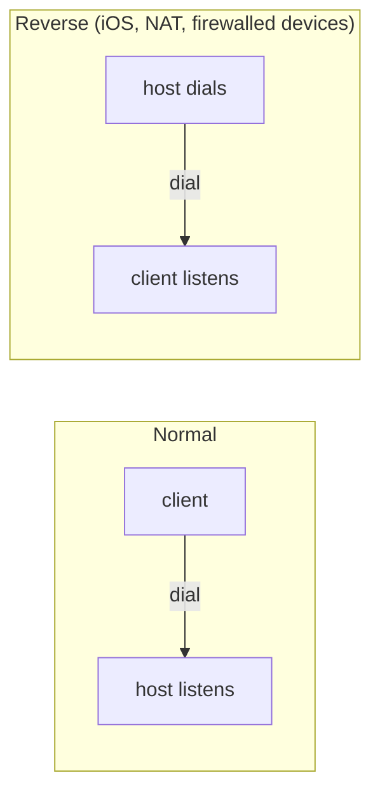

```cpp
Rhp::host<cfg>   host{ Rhp::endpoint::dial("10.0.0.5", 7777), keys, signers };   // on the phone
Rhp::client<cfg> c   { Rhp::endpoint::listen("0.0.0.0", 7777), identity };      // on the dev PC
```

iOS: suspended apps can't service listeners, so prefer reverse mode; add `NSLocalNetworkUsageDescription` (and `NSBonjourServices` for discovery) to Info.plist.

### 6.5 HTTP REST gateway

For curl and scripts, a stateless gateway transport maps HTTP onto ops:

| HTTP | Op |
|---|---|
| `POST /exec` | exec (body = Lua source) |
| `POST /modules/{name}` | load / reload |
| `POST /modules/{name}/call/{fn}` | call (body = msgpack or JSON args) |
| `POST /modules/{name}/revert` · `DELETE /modules/{name}` | revert · unload |
| `GET /modules` · `GET /describe` | list · stubs |

Each request carries `Authorization: RHP key-id, timestamp, nonce, mac` and an `X-RHP-Signature` header for scripts. Gateway requests run under the key's identity (same `lua_State` as that key's other sessions). Non-loopback requires TLS, as for every transport.

---

## 7. Request path

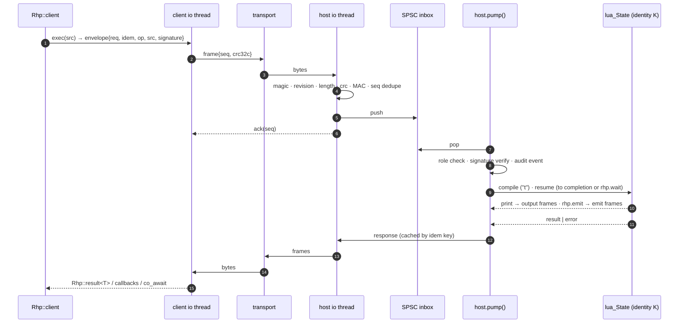

---

## 8. Wire protocol

### 8.1 Frame

```text
 0               4                 5       6       8                16               24          28
 +---------------+-----------------+-------+-------+----------------+----------------+-----------+
 | magic "RHP\0" | protocol_rev u8 | flags |  op   |      seq       |      ack       |  length   |
 +---------------+-----------------+-------+-------+----------------+----------------+-----------+
 |                         payload (MessagePack, `length` bytes, ≤ 4 MiB)                         |
 +-----------------------------------------------------------------------------------------------+
 | crc32c 4B (omitted under TLS) | [ keyed-BLAKE2b MAC 32B on loopback/IPC ]                      |
 +-----------------------------------------------------------------------------------------------+
```

| Field | Purpose |
|---|---|
| `magic`, `protocol_rev` | reject garbage; `protocol_rev` is a plain integer agreed in `hello` |
| `flags` | `MAC`, `ACK_REQ`, `MORE` (fragment of a blob/large payload), `CRC_OMITTED` |
| `op` | 16 bits: `hello, challenge, response, welcome, resume` (handshake) · `exec, load, call, reload, rollback, unload, revert, revert_to, checkpoint, revert_all, cancel, list, status, describe, pin, unpin, blob` (requests) · `output, emit, result, error` (replies) · `ping, pong, ack, nack` (control) — see X5 |
| `seq` / `ack` | per-session monotonic + cumulative ack |
| `length` | ≤ `max_frame` (4 MiB), checked **before** allocating; blobs larger than that are fragmented (`MORE`) |
| `crc32c` | catches corruption TCP's checksum misses; dropped under TLS (AEAD covers it) |
| MAC | loopback/IPC integrity + replay protection (`seq` inside the MAC) |

The header is fixed binary; only the payload is MessagePack (maps 1:1 onto Lua values).

### 8.2 Reliability ("error correction")

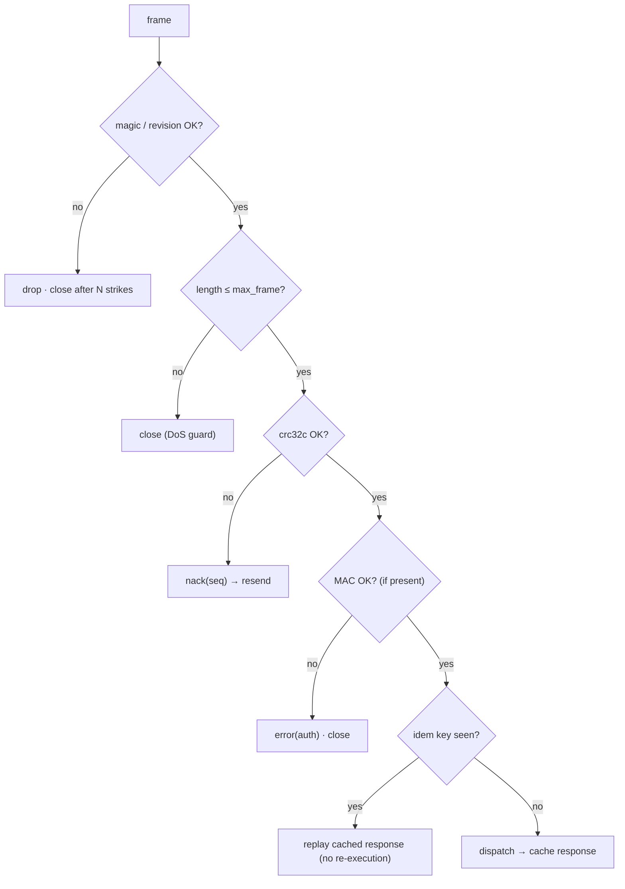

| Mechanism | Guards against |
|---|---|
| CRC32C | corruption on non-TLS links |
| seq/ack + resend window | loss across reconnects |
| resume token (from handshake) | re-attaching to in-flight requests after reconnect |
| idempotency key + bounded response cache | double execution on retry |
| ping/pong (2 s, dead after 3 misses) | half-open sockets, sleeping radios |
| capped exponential backoff + full jitter | reconnect storms |
| **UDP-reliable transport** | own fragmentation + selective ack + retransmit; optional FEC policy (the only place FEC applies) |

### 8.3 Session state machine

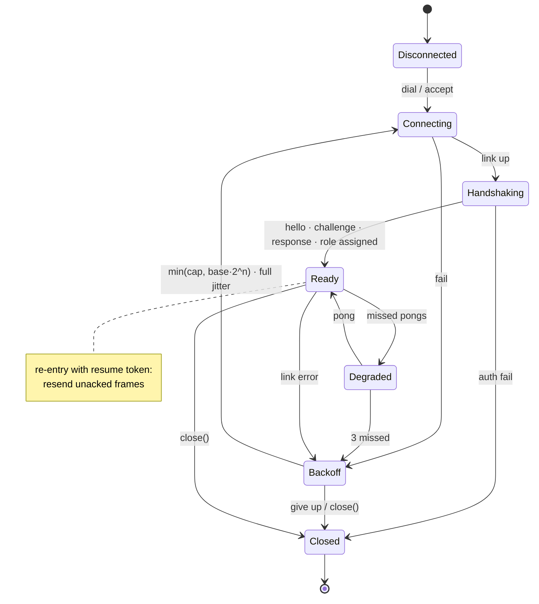

---

## 9. Security

| Layer | Decision |
|---|---|
| Bind address | loopback / local IPC by default; non-loopback requires a keyring **and** TLS (or an explicit `insecure_lan` opt-in) |
| Authentication | `psk_keyring`: mutual challenge-response, keyed BLAKE2b (Monocypher); each key maps to an **identity** and a **role** |
| Roles | `observe` (read, pure calls) · `patch` (mutations, load/revert) · `admin` (revert_all, blobs, `io`, admin-tagged bindings) |
| Script signing | Ed25519 (Monocypher): host only runs code signed by a trusted developer key; `rhp-cli` signs automatically with the identity's private key |
| Channel | TLS 1.3 on networks: OpenSSL (desktop) / mbedTLS (iOS, Android) behind `tls::auto_backend`; keyed-BLAKE2b frame MAC on loopback/IPC |
| Sandbox | allowed libs: `string`, `table`, `math`, `utf8`, `coroutine`, `os.time`/`os.clock`; **full standard library for `kAdmin`** — `io`, `os` (incl. `execute`, `getenv`, `remove`, `rename`), `package.loadlib`, `debug` (decided: an admin key is fully trusted; `package.loadlib` can't load unsigned native code on iOS anyway); no `debug`, `package`, `dofile`, binary chunks (`load` forced to `"t"`), `string.dump` |
| Limits | unlimited, run to completion by default; cancel always works; optional sticky totals / slicing per role |
| Connections | unlimited concurrent clients per host (decided) — every one must authenticate |
| Discovery leak | mDNS TXT advertises host name, platform, protocol_rev, app name + build id, installed lib names **only when the host opts in** (off by default). Never keys. `discovery<Rhp::net::no_discovery>` turns it off |
| Audit | `Rhp::event::script_executed {identity, role, op, module, hash, signer, time}` + optional file sink |
| Kill switches | compile-time `RHP_ENABLE=OFF` (host becomes a stub, patch points become direct calls) **and** runtime `host.set_enabled(false)` |

> **iOS/App Store:** remote code that changes app behavior is restricted by store policy. Target dev/QA/enterprise builds; compile out with `RHP_ENABLE=OFF` for store builds. Check current Apple guidelines before shipping.

---

## 10. Threading

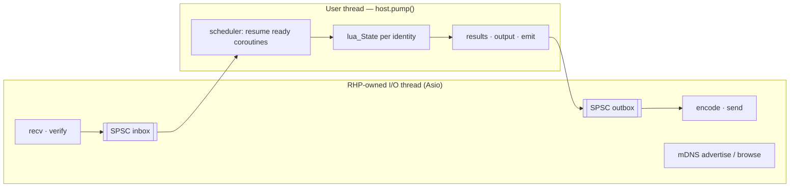

| Decision | Choice |
|---|---|
| Who runs Lua | `exec::pumped`: the thread calling `pump()` |
| Who runs network I/O | `exec::owned_io_thread`: one `std::jthread` running Asio (alternatives: `zero_threads` = user polls, `external_io_context`) |
| Memory | every RHP allocation goes through an injectable `std::pmr::memory_resource*` (Lua allocator included) |
| Isolation | one `lua_State` per **key identity**, one `_ENV` per module; identities never share a state |
| Concurrency rule | each `lua_State` is owned by exactly one thread; only the SPSC rings and the cancel flag cross threads |
| Hosts per process | many; **no globals** in hosts (decided) |
| Patch points / lua_events | one **process-wide registry**; any host may patch/deliver; stacking order = global ledger seq |
| Patch point hit off the pump thread | Lua states aren't thread-safe, so the call runs the **C++ default** and increments a per-point `off_thread_misses` counter (shown in `status`) |
| `lua_event` delivery | synchronous when fired on the owning pump thread, queued to the next `pump()` otherwise; fire-and-forget (no return values — use patch points to modify behavior) |
| Clock | `clock<>` policy, `steady_clock` default; inject game time or a manual clock for deterministic tests |

---

## 11. Repository layout

```text
RHP/
├── CMakeLists.txt
├── CMakePresets.json
├── .clang-format                  # 4 spaces, attached braces (rest: see F20)
├── README.md
├── LICENSE                        # Apache-2.0
├── NOTICE
├── cmake/
│   ├── CPM.cmake
│   ├── Dependencies.cmake         # every pin in one place
│   ├── RhpOptions.cmake
│   ├── RhpWarnings.cmake
│   ├── RhpSanitizers.cmake
│   └── RhpPlatform.cmake
├── Src/
│   ├── CMakeLists.txt
│   └── rhp/
│       ├── rhp.hpp                # umbrella
│       ├── CMakeLists.txt
│       ├── utils/      fixed_string · type_list · function_traits · scope_guard · spsc_ring
│       │               byte_buffer · crc32c(.cpp) · units · overloaded · detail/
│       ├── core/       error · result · errors_mode · value(.cpp) · convert · ids · log(.cpp) · limits
│       ├── platform/   os · random(.cpp)                                    (Stage 3) ← only OS #ifdefs
│       ├── wire/       ops · frame(.cpp) · codec · codec/msgpack(.cpp) · messages(.cpp)   (Stage 3)
│       ├── net/        endpoint · io_context(.cpp) · link · loopback/ · tcp/          (Stage 3)
│       │               local/ · websocket/ · udp_reliable/ · http_gateway/ · mdns/     (later)
│       ├── security/   authenticator · key(.cpp) · keyring(.cpp) · psk_keyring(.cpp)  (Stage 3)
│       │               signer · ed25519(.cpp) · tls/{openssl,mbedtls,auto_backend}     (later)
│       ├── exec/       executor (pumped, steady_clock) · io_runner (owned_io_thread, zero_threads)
│       ├── script/     stack · marshal · lib · patch_point · ledger · sandbox     (Stage 1)
│       │               lua_event · stubs · scheduler, revisions, require in sandbox (Stage 2)
│       │               hook_backend · audit                                       (later)
│       │               puc_lua/(.cpp — lua.h never leaks) · detail/
│       ├── session/    session(.cpp): handshake · seq/ack/nack · MAC · heartbeat   (Stage 3)
│       │               resume · backoff                                              (Stage 5)
│       ├── config/     config — the Rhp::config<> chain                              (Stage 3)
│       ├── host/       host · detail/engine — host.cpp                               (Stage 3)
│       │               blob_sinks · events · local_api                               (later)
│       └── client/     client · detail/engine — client.cpp                           (Stage 3)
│                       fleet · async_stream · task                                   (later)
├── Tests/
│   ├── CMakeLists.txt
│   ├── unit/          mirrors Src/rhp/* — files named `<thing>_tests.cpp`
│   ├── support/       header-only test helpers (`rhp_test/…`)
│   ├── integration/   loopback · tcp · tls · reconnect_resume · revert_matrix · roles · signing · fleet
│   ├── compile_fail/  bad concepts, duplicate names — ctest WILL_FAIL
│   ├── fuzz/          frame · envelope · msgpack · sandbox_escape
│   └── bench/         patch_point_call · frame_roundtrip · exec_latency · slice_overhead
├── Examples/
│   ├── hello_console/     exec · expose · patch points · load/revert/rollback, local + over TCP
│   ├── custom_transport/  writing your own Rhp::net::transport
│   └── headless_server/   threaded server host, roles, audit, fleet + mDNS
├── Tools/
│   └── rhp-cli/           REPL (replxx, CLI11): connect · exec · load · revert · rollback · pin · stubs · watch · run · keygen · sign
├── Scripts/               sample .lua used by examples/tests
└── Docs/
    ├── ARCHITECTURE.md
    └── decisions/         one file per decision, named by topic (`lua-runtime.md`, no numbers)
```

Rules:
1. Top level capitalized (`Src`, `Tests`, `Examples`, `Tools`, `Docs`); everything under `Src/rhp/` is **lowercase** because it's an include path and Linux/Android/iOS are case-sensitive.
2. Folder ↔ namespace: `Src/rhp/script/` ⇔ `Rhp::script`; `detail/` ⇔ `Rhp::script::detail`.
3. One `CMakeLists.txt` per module folder, files listed explicitly, no `GLOB_RECURSE`.
4. Third-party headers (`lua.h`, `asio.hpp`, OpenSSL, mbedTLS, Monocypher, msgpack) only in `.cpp` files.
5. `.hpp`/`.cpp`, `#pragma once`, 4-space indent, attached braces.
6. No `v1`/`v2`/`V*` in any identifier, file, folder, namespace, or tag.

---

### 11.1 Code style (decided)

| Rule | Choice | Example |
|---|---|---|
| Types, functions, variables, namespaces | `snake_case` | `module_manager`, `revert_all()` |
| Root namespace | `Rhp::` | `Rhp::script::lib` |
| Constants & enum values | `kPascal` | `Rhp::errc::kForbidden`, `Rhp::role::kAdmin`, `kDefaultRevisions` |
| Template parameters | short PascalCase | `template <net::transport T>`, `Cfg`, `Fn` |
| Data members | trailing underscore | `ledger_`, `sessions_` |
| Macros | `RHP_*` | `RHP_ENABLE` |
| Constraints | constrained parameters in the list, not trailing `requires` | `template <Rhp::convertible T>` |
| `template <...>` | always on its own line | |
| Indent / braces | 4 spaces, attached braces | `void f() {` |
| Column limit | none (`ColumnLimit: 0`) | |
| Pointers | `int* p`, `int& r` | |
| One-line functions | only empty or in-class inline | |
| Include order | std → third-party → rhp | |
| Strings | `std::string_view` in, `std::string` out, UTF-8 everywhere | |
| Files | `.hpp` / `.cpp`, `#pragma once`; pure templates header-only, `.cpp` only for dependency walls | |
| Log levels | `trace, debug, info, warn, error, critical` | |
| Naming taboo | no `v1`/`v2`/`V*` anywhere | |

```cpp
namespace Rhp::script {

template <net::transport T, Rhp::convertible R>
class request_handle {
public:
    [[nodiscard]] Rhp::result<R> wait() const;
    bool done() const noexcept { return done_; }

private:
    T* transport_ = nullptr;
    bool done_ = false;
};

inline constexpr std::size_t kDefaultRevisions = 8;

}
```

## 12. CMake

### 12.1 Targets

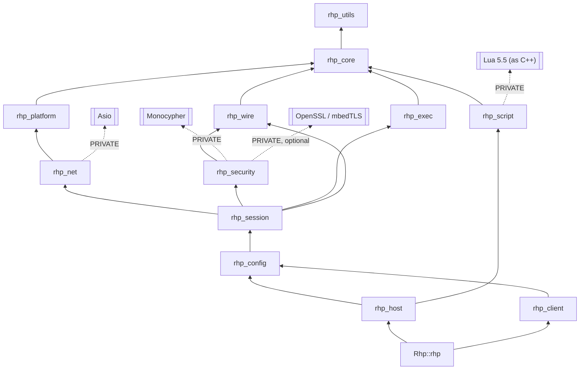

### 12.2 Options

| Option | Default | Effect |
|---|---|---|
| `RHP_ENABLE` | `ON` | `OFF` → inert host, direct-call patch points |
| `RHP_BUILD_TESTS` / `RHP_BUILD_EXAMPLES` / `RHP_BUILD_TOOLS` | `ON` when top-level | |
| `RHP_WITH_TLS` | `ON` | OpenSSL desktop / mbedTLS mobile |
| `RHP_WITH_WEBSOCKET` · `RHP_WITH_UDP` · `RHP_WITH_HTTP` · `RHP_WITH_MDNS` | `ON` | optional transports / discovery |
| `RHP_SANITIZE` | empty | `address;undefined` or `thread` |
| `RHP_WARNINGS_AS_ERRORS` | `ON` | `/W4 /WX` · `-Wall -Wextra -Wpedantic -Werror` |

### 12.3 Presets (Ninja Multi-Config; opens directly in Visual Studio)

| Configure preset | Toolchain | Tests run |
|---|---|---|
| `windows-msvc` | MSVC (VS 2026), Windows 10 1809+ | ✅ |
| `windows-clang-cl` | clang-cl | ✅ |
| `windows-msvc-asan` | MSVC AddressSanitizer | ✅ |
| `linux-clang` / `linux-clang-asan` / `linux-clang-tsan` | Clang 17+, glibc 2.31+ | ✅ |
| `macos` | AppleClang, `arm64;x86_64`, macOS 13+ | ✅ |
| `ios-sim` | Xcode + AppleClang, `CMAKE_SYSTEM_NAME=iOS`, iOS 16+, simulator | ✅ via `xcrun simctl spawn` as crosscompiling emulator |
| `ios-device` | Xcode, arm64 | build only |
| `android-x64` | NDK r30 Clang, API 26+ | ✅ on emulator via `adb` |
| `android-arm64` | NDK r30 clang | build only |

```bash
cmake --preset windows-msvc
```

```bash
cmake --build --preset windows-msvc --config Debug
```

```bash
ctest --preset windows-msvc -C Debug
```

### 12.4 Consuming RHP (CPM / add_subdirectory)

```cmake
CPMAddPackage(NAME rhp GITHUB_REPOSITORY tonytranrp/RHP GIT_TAG <commit-sha>)
target_link_libraries(my_game PRIVATE Rhp::rhp)
```

---

## 13. Testing

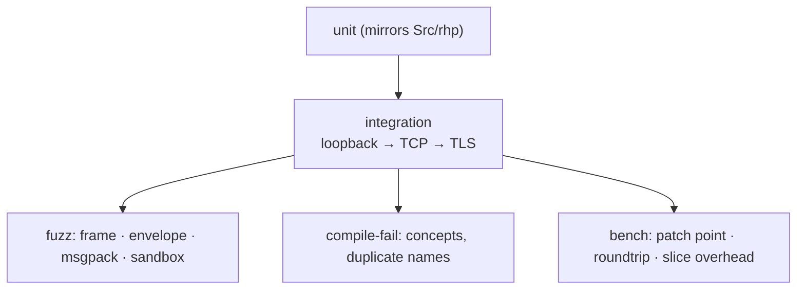

Must-have cases: revert matrix (every effect kind × load/reload/rollback/revert/revert_to/unload × cross-module interleaving) · transactional reload · scheduler (cancel from the I/O thread stops an infinite loop inside `pump()`; opt-in `slice_us` yields on time) · sandbox escapes · roles (observe can't mutate) · signing (unsigned/wrong-key rejected) · reconnect+resume exactly-once · CRC corruption → nack → resend · blob fragmentation · boundary instantiations (`Rhp::config<>`, empty `Rhp::lib<"x">`, `void` returns, minimal user transport).

**CI:** none yet (decided). Every preset above runs locally with `ctest`; a GitHub Actions workflow mirroring the preset table is a later stage.

---

## 14. Errors

```cpp
namespace Rhp {
enum class errc : std::uint16_t {
    kOk, kTransport, kProtocol, kProtocolRevisionMismatch, kAuth, kForbidden, kBadSignature, kIntegrity, kTimeout,
    kCompile, kRuntime, kBudgetExceeded, kMemoryExceeded, kStaleHandle,
    kNotFound, kAlreadyLoaded, kHasDependents, kRevertPartial, kIrreversible, kCancelled, kLimitExceeded, kDisabled
};
struct error { errc code; std::string message; std::string where; std::string traceback; };
template <class T> using result = std::expected<T, error>;
struct exception : std::exception { error err; /* what() → err.message */ };
}
```

- `Rhp::errors::expected` (default): APIs return `Rhp::result<T>`.
- `Rhp::errors::throwing`: same APIs return `T` and throw `Rhp::exception`. `Rhp::unwrap(r)` converts one call.
- Internally exceptions are allowed; they never cross the public API in `expected` mode. Lua is compiled as C++, so `lua_error` unwinds with exceptions and RAII stays correct; binding trampolines turn C++ exceptions into Lua errors.
- RTTI allowed.

---

## 15. Dependencies

All PRIVATE; none of their headers appear in `Src/rhp/**/*.hpp`.

| Need | Pick | License |
|---|---|---|
| Script engine | PUC Lua 5.5.1 via CPM, built by us as C++ | MIT |
| Binding | own concept binder (`Rhp::lib<>`) | — |
| Async I/O | standalone Asio 1.38.2 (Stage 3) | BSL-1.0 |
| Payload | own MessagePack codec for `Rhp::value` (`Rhp::wire::msgpack`; msgpack-c dropped at Stage 3, W2) | — |
| Integrity | CRC32C (own, HW-accelerated when available) | — |
| Crypto | Monocypher 4.0.3, compiled as C++ (BLAKE2b handshake + frame MAC from Stage 3; Ed25519 in Stage 4) | CC0 / BSD-2 |
| TLS | OpenSSL 4.0.x (desktop) · mbedTLS 4.2 (mobile, custom Asio stream adapter) | Apache-2.0 |
| WebSocket | own RFC 6455 framing on Asio | — |
| HTTP gateway | own minimal HTTP/1.1 parser on Asio | — |
| mDNS / DNS-SD | platform APIs behind `Rhp::net::discovery`: `dns_sd` (Apple), Windows DNS-SD API, Avahi or own responder on Linux, NSD bridge on Android — exact per-OS choice researched at Stage 6 | — |
| Tests | Catch2 v3.16 | BSL-1.0 |
| Bench | Google Benchmark | Apache-2.0 |
| Fetching | CPM.cmake 0.42.x | MIT |

Apache-2.0 for RHP is compatible with all of the above.

---

## 16. Stages

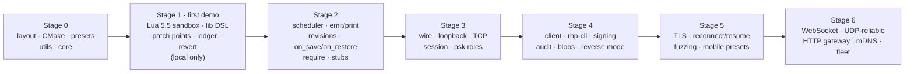

| Stage | Done when |
|---|---|
| 0 ✅ | `cmake --preset windows-msvc` + `ctest` green with utils/core tests — done: 54 tests green on MSVC, clang-cl, MSVC-ASan, Linux Clang, Clang ASan+UBSan, Clang TSan |
| 1 ✅ | `Examples/hello_console` runs a local Lua file calling exposed C++, patches a point, and reverts everything — done: 118 tests (56 script) green on MSVC, clang-cl, MSVC-ASan, Linux Clang, Clang ASan+UBSan, Clang TSan; the `RHP_ENABLE=OFF` build is green without Lua |
| 2 ✅ | an infinite-loop script never blocks a frame; reload keeps state via `on_save`/`on_restore`; LuaLS stubs generated — done: `Examples/frame_loop` pumps 120 frames next to a `while true do end` (2 ms slices, worst frame ≈ 2 ms), reloads a module keeping its state and writes `rhp_api.lua`; 239 tests green on MSVC, clang-cl, MSVC-ASan, Linux Clang, Clang ASan+UBSan, Clang TSan; the `RHP_ENABLE=OFF` build (99 tests) is green without Lua |
| 3 ✅ | exec over loopback and TCP with CRC, seq/ack, roles — done: `Examples/remote_exec` runs three keys (admin / patch / observe) against one host over loopback and TCP on 127.0.0.1, streams print back, cancels a `while true do end` from the network thread while the game thread is stuck in it, and reverts a client's effects when it disconnects; `Examples/custom_transport` plugs a user transport into `Rhp::config<>`; STAGE3_COUNTS |
| 4 | full lifecycle from `rhp-cli`, signed scripts only, audit log written |
| 5 | TLS on all 5 OS presets; kill-the-socket test resumes exactly-once |
| 6 | fleet finds hosts via mDNS and broadcasts a script |

---

## 17. Research basis (2026-10-08)

| Finding | Consequence |
|---|---|
| Lua 5.4.9 is the final 5.4 release; 5.5.1 current | Lua 5.5 only |
| sol2 inactive since Mar 2025, breaks on GCC 15 / Lua 5.5 | own binder (also needed for ledger tracking) |
| Binary chunks unverified, can crash the VM | `load` forced to `"t"`, `string.dump` removed |
| Lua 5.4+ count hooks may `lua_yield` | time-sliced scheduler makes "unlimited" safe for pumped hosts |
| Lua compiled as C++ unwinds with exceptions | RAII-safe trampolines |
| `_ENV` isolation leaks via shared metatables | separate `lua_State` per identity |
| Owner-keyed cleanup (GMod hooks, Neovim augroups, Roblox Maid) | ledger design |
| `std::execution` has no networking until C++29 | Asio behind our transport concept |
| iOS: no listening while suspended; local-network prompt | reverse mode, Info.plist keys |
| Asio TLS speaks only OpenSSL | mbedTLS needs our own stream adapter |
| Monocypher has no SHA-256/HMAC | BLAKE2b MAC; audit hash choice in F19 |
| TCP checksum misses ~1 in 10^8–10^9 packets | CRC32C when not under TLS |

Sources: lua.org/versions.html · github.com/ThePhD/sol2 · github.com/kunitoki/LuaBridge3 · luau.org/sandbox · think-async.com/Asio · open-std.org P4048R0 · github.com/msgpack/msgpack-c · monocypher.org · Apple TN3151/TN3179 · developer.android.com/ndk · github.com/catchorg/Catch2.

---

## 18. Decision log (round 1)

| # | Topic | Decision |
|---|---|---|
| 1 | Name | Remote Hot Patch |
| 2 | Use cases | game patching/modding · live tuning · QA automation · server ops · RE/research |
| 3 | Standard | C++23 |
| 4 | Form | static library |
| 5 | License | Apache-2.0 |
| 6–7 | Naming | snake_case everything, root namespace `Rhp::` |
| 8–9 | Platforms | Windows, Linux, macOS, iOS, Android · x86_64, arm64 |
| 10 | Compilers | MSVC (VS 2026), clang-cl, Clang 17+ (see F1 for Apple/NDK) |
| 11–12 | Exceptions / RTTI | internal only, never across API · RTTI allowed |
| 13–14 | Lua | PUC Lua 5.5, built by us as C++ via CPM |
| 15 | Isolation | `lua_State` per client identity, `_ENV` per module |
| 16–17 | Binding | own concept binder · functions + opaque handles |
| 18 | Stdlib | string, table, math, utf8, coroutine, os.time/clock, io (admin-gated) |
| 19 | Stubs | LuaLS annotations from `Rhp::lib` |
| 20 | require | host-controlled loader |
| 21 | Persistence | in-memory only |
| 22–24 | Output / async | print → both · `rhp.emit` streaming · coroutine scheduler |
| 25 | Limits | unlimited totals, time-sliced pump |
| 26–27 | Hooking | patch points only, user `hook_backend` · atomic pointer, direct call when disabled |
| 28–30 | Effects | exec keeps (scratch module) · irreversible allowed + reported · fault → auto-revert, stay Faulted |
| 31–33 | History | last N revisions · `on_save`/`on_restore` · global checkpoints |
| 34 | Local API | yes |
| 35 | Transports | TCP, local IPC, loopback, WebSocket, TLS, UDP-reliable, HTTP REST |
| 36–39 | Topology | both directions · many isolated clients · `Rhp::fleet` · mDNS |
| 40–43 | Wire | Asio · MessagePack · no compression · 4 MiB frames |
| 44 | Blobs | yes, host-registered sinks |
| 45–49 | Security | PSK + signed scripts · OpenSSL + mbedTLS · roles per key · audit · compile-time + runtime kill switch |
| 50–53 | Threads / memory | pumped · RHP-owned I/O thread · blocking + co_await + callbacks + future · `std::pmr` |
| 54–56 | Errors / log / format | expected + throwing · own logger concept · `std::format` |
| 57–58 | Reflection / modules | no · headers only |
| 59–62 | Build | CPM · consumed via CPM/add_subdirectory · CMake 3.28 · Ninja Multi-Config |
| 63–65 | Env | Visual Studio · Catch2 v3 · no CI yet |
| 66–69 | Style | custom clang-format · 4 spaces, attached braces · lowercase include tree · `.hpp`/`.cpp` |
| 70–75 | Extras | Markdown docs · rhp-cli · no C API · C++ clients only · examples: hello_console, custom_transport, headless_server · compile-time extensions only |
| 76 | First demo | local Lua calling C++ + revert (Stage 1) |
| 77 | Versioning | no `v1`/`v2`/`V*` anywhere; progress = stages |

---

## 19. Decision log (round 2)

| # | Decision |
|---|---|
| F1 | AppleClang + Android NDK Clang added |
| F2–F4 | `Rhp::` root, snake_case sub-namespaces, `<rhp/...>`, CMake `Rhp::rhp`, macros `RHP_*` |
| F5 | full `io` for `kAdmin` |
| F6 | disconnect → revert immediately (after heartbeat window, §5.7) |
| F7–F8 | all code signed (CLI signs transparently); `kObserve` may run unsigned |
| F9 | scripts run to completion; slicing opt-in; cancel via atomic flag |
| F10–F11 | revisions configurable (default 8) · scratch module per identity |
| F12 | unload with dependents refused unless `force` |
| F13 | fleet: parallel, collect all |
| F14–F15 | WebSocket for proxy traversal only · HTTP/1.1 own parser |
| F16–F17 | platform DNS-SD APIs · TXT: host, platform, protocol_rev, app + build id, lib names |
| F18–F19 | blobs: `kAdmin`, 256 MiB · audit hash BLAKE2b-256 |
| F20–F22 | no column limit · `int* p` · one-liners only empty/in-class · std → third-party → rhp · `template <>` own line · constrained params · `T`/`Cfg` · `x_` · `kPascal` constants |
| F23–F25 | header-only templates, `.cpp` walls · env + files keys (keychain later) · injectable clock |
| N1–N3 | Lua global `rhp` · `M.on_load` etc. as module fields · dotted lowercase patch ids |
| N4 | no default port |
| N5 | Win10 1809 · macOS 13 · iOS 16 · Android API 26 · glibc 2.31 |
| N6–N7 | ping 2 s / 3 misses / backoff 250 ms→30 s · unlimited clients |
| N8–N10 | log levels trace→critical · `host.on<>()` returns scoped subscription · `string_view` in / `string` out / UTF-8 |
| N11–N12 | full-featured rhp-cli · TOML-like identity file |
| N13–N16 | stale handle = Lua error · many hosts, no globals · process-wide patch/event registry · `Rhp::lua_event<"name", Args...>` |
| N17 | Stage 0 = folders + CMake + presets, `.clang-format` + `.editorconfig`, utils + core with tests, `Docs/decisions`, per-folder READMEs |

---

## 20. Decision log (round 3)

| # | Decision |
|---|---|
| R1 | run to completion everywhere (cancel flag is the escape hatch) |
| R2 | `pin(mod)` / `unpin(mod)` for admin; pinned modules survive disconnect |
| R3 | HTTP gateway state reverted after 5 min idle |
| R4 | `kAdmin` gets the full Lua standard library |
| R5 | ≤ 64 pending unauthenticated handshakes, 5 s timeout |
| R6 | lib names in mDNS only when the host opts in |
| R7 | off-pump-thread patch point hit → C++ default + miss counter |
| R8–R9 | `lua_event`: sync on pump thread, queued otherwise; fire-and-forget |
| R10–R11 | module names dotted lowercase · revision counter + hash in status |
| R12 | branch + PR per stage, conventional commits |
| R13–R14 | `Docs/decisions/<topic>.md` · tests `<thing>_tests.cpp` |
| R15–R16 | rhp-cli: replxx + CLI11 |
| R17 | `windows-msvc-asan` preset |
| R18 | chunk names `@module_name` |
| R19 | Stage 0 started |

---

## 21. Stage 1 implementation notes

Choices made while building Stage 1 that the questionnaires didn't cover. Each is recorded in the matching `Docs/decisions/` file.

| # | Topic | Decision |
|---|---|---|
| S1 | Local runtime | `Rhp::script::sandbox` is the per-identity runtime (one `lua_State`, one `_ENV` per module, one ledger). Stage 1 uses it directly; `Rhp::host` (Stage 3) owns one per identity. A local sandbox defaults to `role::kPatch` |
| S2 | Patch point declaration | `Rhp::patch_point<"id", &default_fn>`: the default is a template argument (§4.3), so state is `constinit` and registration happens before `main` |
| S3 | Out-of-order revert | variable writes and patch layers live in process-wide per-target stacks; undoing an older write hands its saved value to the next newer one, so any revert order restores exactly |
| S4 | Lib globals | each lib is a locked **userdata** proxy (`__index` / `__newindex`, `__metatable = "locked"`), so `rawset` can't bypass journaling; unknown reads are `nil`, unknown or read-only writes raise `kInvalidArgument` |
| S5 | Errors inside Lua | RHP raises strings formatted `[code] where: message`; when they reach C++ the original `Rhp::error` is recovered (`[code]` is parsed as a fallback) |
| S6 | Environments | a module's `_G` is its own `_ENV`; `load` is text-only for **every** role (admin included) and defaults to the caller's environment; non-admin `os` holds only `time` and `clock` |
| S7 | Stops | cancel and the instruction budget apply to runs (`exec`, `load`, `call`, and handlers they trigger). Once a stop fires the count hook switches to every instruction, so a script that keeps re-entering `pcall` still can't swallow it. Patch handlers hit from game code outside a run are not limited yet (Stage 2 scheduler) |
| S8 | Memory | the Lua allocator goes through `std::pmr`; the memory limit covers the whole `lua_State` and is sticky for the rest of a run; Lua's emergency GC reclaims afterwards |
| S9 | Engine concept | `puc_lua` is the only engine and `Rhp::script::stack` is the engine boundary; a formal `engine` concept for the `config<>::engine<>` slot arrives with a second engine |
| S10 | Deferred to Stage 2 | `Rhp::lua_event`, transactional reload (loading a loaded name returns `kAlreadyLoaded`), `require`, revisions, `on_save` / `on_restore` |
| S11 | `RHP_ENABLE=OFF` | Lua is not fetched or linked; the sandbox is an inert stub returning `kDisabled`; the DSL, the ledger and direct-call patch points still compile |

---

## 22. Decision log (round 4, Stage 2)

| # | Topic | Decision |
|---|---|---|
| T1 | Time slicing | opt-in only: `limits.slice_us = 0` stays the default; the Stage 2 "never blocks a frame" check runs with slicing on |
| T2 | Cancel vs waits | `cancel` kills the whole request: its coroutine, running or suspended. Timers are ledger effects: revert / unload removes them, cancel doesn't |
| T3 | Reload | overlap, then swap: the new revision runs while the old one is live, `on_restore(on_save())` carries state, then the old revision is reverted. A failure reverts only the new revision; the old one is untouched |
| T4 | Revisions | the last N sources (+ hash, counter) are kept; `rollback(mod, n)` is a reload of a stored source, so state carries through `on_save` / `on_restore` |
| T5 | `require` cycles | a cycle fails with a clear error; `require` returns a read-only live proxy that always reads the module's current exports |
| T6 | Force unload | without `force`: `kHasDependents`. With `force`: dependents stay loaded and touching the unloaded module raises `kUnloaded` |
| T7 | `rhp.emit` | `sandbox_options::on_emit` callback, called immediately on the pump thread, in order with `print`; emitted values are not part of the return list |
| T8 | Stubs | filtered by role: entries the role can't call are left out, variables are marked read-only for `observe`; the `rhp` API and module hooks are included |
| T9 | `lua_event` delivery | synchronous when fired on the sandbox's thread, queued to the next `pump()` otherwise; each handler is ledger-tracked |
| T10 | Handlers outside a run | every patch / event handler call that game code triggers is its own small run: cancel, instruction and wall budgets apply per call; a stop faults the module and the C++ default runs |
| T11 | Re-entrant lifecycle ops | `revert` / `unload` / `reload` / `rollback` / `revert_to` / `revert_all` called from inside a running script are queued and applied when the outermost run returns (or at the next `pump()` for handlers game code triggered); they report `deferred` |
| T12 | Workflow | main session writes the core; one subagent (no nested agents) writes stubs and tests; branch `stage-2-scheduler`, PR |

---

## 23. Stage 2 implementation notes

Choices made while building Stage 2 beyond the round-4 questionnaire (§22). Each is recorded in the matching `Docs/decisions/` file.

| # | Topic | Decision |
|---|---|---|
| U1 | Requests | every `exec` / `load` / `call`, timer callback and event handler is a **request**: a coroutine with its own instruction / wall budget. An operation whose request suspends returns early (`exec` / `call`: empty list, `load`: module `kLoading`, `reload`: revision 0) and the final result goes to `sandbox_options::on_result`; `last_request()` names it |
| U2 | Who may suspend | only a request's own thread, when yieldable. Patch handlers, `on_save` / `on_restore` / `on_unload`, coroutines a script created and callbacks of C functions (`table.sort`) can't; `rhp.wait` there raises `kInvalidArgument`. `coroutine.resume` / `close` refuse request coroutines |
| U3 | Frames and time | `rhp.wait(n)` counts `pump()` calls (n < 1 → 1); `rhp.sleep` and `rhp.timer` use the injectable `sandbox_options::clock`; limits always use `steady_clock`. A pump resumes only requests ready when it started, round robin, and stops once its slice is spent |
| U4 | Slices | `slice_us` applies per operation, per `pump()` and per synchronous event delivery from game code; the count hook yields only the request's own thread, so a loop inside a coroutine the script created can't be sliced (cancel and limits still stop it) |
| U5 | `wall_ms` | per request (summed over resumes) or per handler call; errc `kTimeout` |
| U6 | Revisions | each revision has its own `_ENV`; ledger entries carry module, revision and request (`effect_owner`), so a reload reverts exactly the old revision and a failed `exec` exactly its own request. Revision numbers are consumed by failed reloads too; `status` shows revision, CRC-32C source hash, revisions kept and `reloading` |
| U7 | Reload swap | the old revision's effects, timers, subscriptions and suspended requests go at the swap — including game-state writes; state crosses only through `on_save` / `on_restore`. `load` of a loaded name is a reload; `rollback(mod, n)` reloads a kept source as a new revision |
| U8 | Timers | `rhp.timer(ms, fn, repeating)` → id usable with `rhp.off`; a repeating timer fires at most once per pump and skips missed ticks |
| U9 | Faults | outside a run a failing request faults its module at once; inside a run, and for handlers game code triggered, at the end of the outermost operation or the next `pump()`. A stop of the surrounding run (cancel, a limit) never faults a handler's module |
| U10 | Events | `Rhp::lua_event<"name", Args...>` registers on first use of `fire`; arguments are `Rhp::convertible` or opaque handle types; `listeners()` counts subscribed sandboxes |
| U11 | Errors | new `errc::kUnloaded`; `Rhp::kLastErrc` marks the last code |
| U12 | Cancel delivery | a `cancel(request)` for a suspended request stays pending until that request would resume, which ends it instead (or the next operation / `pump()` does). `on_result` for timer and event requests carries no values; destroying a sandbox ends its suspended requests without `on_result` |

---

## 24. Decision log (round 5, Stage 3)

| # | Topic | Decision |
|---|---|---|
| W1 | Client scope | Stage 3 ships a **blocking** `Rhp::client<Cfg>` with every sandbox-backed op (`exec`, `load`, `call`, `reload`, `rollback`, `revert`, `unload`, `checkpoint`, `revert_to`, `revert_all`, `cancel`, `list`, `status`, `describe`) and `on_output` / `on_emit`; async calls, futures, `co_await`, `fleet` and `rhp-cli` are Stage 4 |
| W2 | Codec | RHP's own MessagePack codec for `Rhp::value` (`Rhp::wire::msgpack`): no dependency, counts and depth checked before allocating, easy to fuzz. msgpack-c is dropped (its Boost-free mode is still experimental); another codec can still plug into `config<>::codec<>` |
| W3 | Disconnect | without resume (Stage 5) a session ends when its link closes or its heartbeat dies (3 × 2 s); the identity's last session ending cancels its requests from the network thread, reverts and unloads everything and closes its `lua_State` |
| W4 | I/O threading | `exec::owned_io_thread` (default: one `std::jthread` runs Asio) and `exec::zero_threads` (`pump()` and blocking client calls poll the network) |
| W5 | Crypto | Monocypher 4.0.3 moves to Stage 3: the PSK mutual challenge-response derives per-direction keys, and every frame after the handshake carries a 32-byte keyed-BLAKE2b MAC over header + payload (seq inside, so replays fail) |
| W6 | Non-loopback | loopback addresses always; anything else fails with `kForbidden` unless the endpoint says `Rhp::net::insecure_lan` (until TLS in Stage 5) |
| W7 | Reliability | cumulative ack, an unacked resend window, CRC failure → nack → resend, a bounded idempotency-key response cache, ping/pong heartbeat; resume tokens and reconnect/backoff are Stage 5 |
| W8 | Example | new `Examples/remote_exec` (loopback, then TCP; three keys and roles); `hello_console` stays the local demo |
| W9 | Config | `Rhp::config<>` gets the Stage 3 slots only: transport, codec, auth, executor, io, limits, errors, clock, logger; TLS / signer / discovery slots come with their stages |
| W10 | Signing | Stage 3 runs unsigned scripts from any authenticated role; roles still gate what they can do. Signatures become mandatory (except for observe) in Stage 4 |
| W11 | Output routing | print / `rhp.emit` / results go to the session whose request caused them; output from timers, event handlers or requests whose session is gone goes to every live session of the identity (and the host logger at debug) |
| W12 | Workflow | the main session writes and tests everything; one subagent (no nested agents) reviews the finished stage for bugs at the end; branch `stage-3-wire-session`, PR |

---

## 25. Stage 3 implementation notes

Choices made while building Stage 3 beyond the round-5 questionnaire (§24). Each is recorded in the matching `Docs/decisions/` file.

| # | Topic | Decision |
|---|---|---|
| X1 | Compile once | `Rhp::host<Cfg>` / `Rhp::client<Cfg>` are thin templates: the config is type-erased into a `setup` (`net::transport_ops`, `wire::codec_ops`, a handshake factory, limits, logger, clock) and the engines (`host.cpp`, `client.cpp`) compile once. The session layer never sees a policy type: only `net::link`, `wire::codec_ops`, `security::host_handshake` / `client_handshake` and `wire::frame_sealer` |
| X2 | Modules | new folders: `platform` (OS name, secure random — the only OS `#ifdef`s), `wire`, `net`, `security`, `exec`, `session`, `config`, `host`, `client`. `net` depends on `platform` (not `wire`); `session` on `net`, `security`, `exec`, `wire`; `config` on all four policy layers |
| X3 | Messages | every request and reply payload is an `envelope {req, idem, body}`; `wire/messages.hpp` defines each body with an `Rhp::convert` specialization. A request gets exactly one `kResult` or `kError`; `kOutput` / `kEmit` carry the request id (0 = none). Modules are named by id or name (`wire::module_ref`). Decoders ignore unknown keys |
| X4 | Handshake | hello → challenge (host proof) → response (client proof, sent only after the host's proof checks out) → welcome, the first MAC'd frame. An unknown key name gets a normal challenge made with a random secret. Garbage before the handshake closes the connection at once; after it, three resync strikes |
| X5 | Frames | the 28-byte header of §8.1 with a 16-bit op; ops 1–15 handshake, 16–47 requests, 48–63 replies (sequenced), 64+ control (unsequenced: ping, pong, ack, nack); a session-ending error is an unsequenced `kError` (sealed once keys exist). `kWelcome` joins the op list; `kResume`, `kPin`, `kUnpin`, `kBlob` are reserved |
| X6 | Nack | a nack's `ack` field is the last good seq: the peer resends everything after it (one nack per gap). A whole heartbeat without ack progress also resends the window, covering a lost nack |
| X7 | Identities | a sandbox per identity is created when its first session is welcomed (caller role = the key's role, every installed lib) and destroyed — `revert_all`, then closed — when its last session ends. Sessions of one identity share it (and its scratch module) |
| X8 | Cancel path | `kCancel` never goes to `pump()`: the network thread applies it through a per-identity *cancel relay* (mutex; cleared before the sandbox dies) that **records** it — per session: cancelled request ids, a cancel-all mark over the network's arrival order, and `dead` once the session ends. The record stops the request running in `pump()` (`sandbox::cancel()`, re-applied every 20 ms because a cancel landing just before the sandbox opens its run scope is cleared by it), suspended ones (`sandbox::cancel(request)`, also checked when a request suspends), and queued ones (answered `kCancelled` without running; a dead session's are dropped). A session that ends stops its own requests even when its identity lives on |
| X9 | Suspended requests | a request whose script suspends (`rhp.wait`, `rhp.sleep`, a time slice) is answered when `sandbox_options::on_result` reports it; the sandbox gained `pending(request)` and a request-aware `on_output` for this |
| X10 | Idempotency | per session, keyed by the client's `idem` (63 random bits): a retry of a finished request is answered from the cache (256 entries), a retry of one in flight waits for the same result |
| X11 | Limits | a reply larger than `max_frame` becomes a `kLimitExceeded` error for that request; an oversized request fails on the client. At most `pending_handshakes` (64) unauthenticated connections; more are closed at once. Before the handshake frames may carry 16 KiB. The MessagePack decoder caps total values (`decode_limits::max_elements`, 2^20) and never reserves more than 256 slots on a count's word. Per session: 4096 requests in flight with an idempotency key, 65 536 held back while `pump()` is behind, 256 / 16 MiB of cached replies — past those the session is closed with `kLimitExceeded`. An exception while receiving ends that session, not the network thread |
| X12 | TCP | `TCP_NODELAY` on every socket; `SO_REUSEADDR` only off Windows (there it would allow port stealing); port 0 = any free port, reported by `host.port()` |
| X13 | Reverse mode | Stage 3 hosts listen and clients dial; the other directions fail with `kInvalidArgument` until Stage 4 |
| X14 | Core additions | `Rhp::value_list`; `Rhp::convert` for `strong_id` (as an integer) and `Rhp::error` (a map; unknown code names decode as `kRuntime`) |
| X15 | `RHP_ENABLE=OFF` | `wire`, `platform`, `config`, `exec` and keys / keyring still build and test; `net`, `session` and the PSK handshake compile to headers only; Asio and Monocypher are not fetched; `Rhp::host` / `Rhp::client` are inert (`kDisabled`) |
| X16 | Monocypher | compiled as C++ through one wrapper translation unit (like Lua), so RHP still needs no C toolchain |
| X17 | Control frames | ping, pong, ack and nack carry their own per-direction counter in `seq` (sealed), so a replayed one is dropped |
| X18 | `zero_threads` clients | the network only runs while a call waits or `client::poll()` runs; an idle client must poll at least once per heartbeat or the host ends its session (and reverts it) |
| X19 | Review | an end-of-stage review (one subagent) found ten issues — a full SPSC ring wiping the item it refused, lost cancels (incl. a disconnect that left a `while true` running for good), MessagePack reserve amplification before authentication, idle `zero_threads` clients dropped, unbounded in-flight / backlog state, event output misrouted, replayable control frames, TCP write-buffer lifetime, loopback posts into a dying context — all fixed with regression tests |
